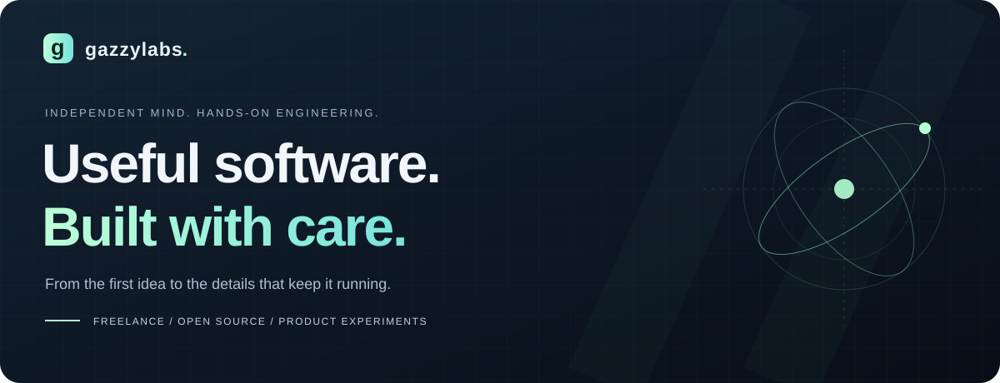
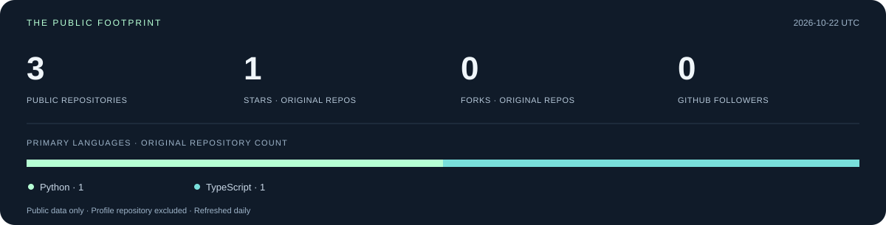

  

  <b>Hi, I’m Gazzy — I build tools that earn their place in everyday life.</b> 
  Full-stack dashboards · Python automation · Bots &amp; integrations · Production tooling

  <a href="#selected-work">Selected work</a> &nbsp; / &nbsp;
  <a href="#engineering-toolkit">Toolkit</a> &nbsp; / &nbsp;
  <a href="#in-the-open">GitHub metrics</a> &nbsp; / &nbsp;
  <a href="#lets-build">Work together ↗</a>

 

## From a real problem to a working product.

GazzyLabs is my space for freelance engineering, open-source work, and entrepreneurial experiments. I like projects where the interface, the backend, and the operational details all matter: a dashboard that explains an outage, a bot that manages limited resources, or a learning tool that makes systems easier to understand.

**Have an idea, an existing product, or a workflow that needs improving?** I’m open to freelance projects and thoughtful collaborations.

## Selected work

### 01 / NetDash
**From “the internet is down” to an explanation.**

A network-monitoring system with a React dashboard, Python collectors, cloud APIs, and Telegram alerts. It combines local probes and an external sentinel to help distinguish home-network failures from ISP outages.

`React` `Node.js` `Python` `PostgreSQL` `Netlify`

**Engineering focus:** incident diagnosis, offline telemetry replay, separate owner and visitor APIs, and actionable alerts.

[Explore the showcase ↗](https://github.com/gazzy-source/netdash-showcase) · [Read the code highlights ↗](https://github.com/gazzy-source/netdash-showcase/blob/main/docs/HIGHLIGHTS.md)

Public architecture and code excerpts; the full application is private. The showcase screenshot uses sample heartbeat history.

---

<table>
<tr>
<td valign="top" width="50%">

### 02 / All-Media Downloader
**A practical bot. A real systems problem.**

A self-hosted Telegram bot for downloading supported public media, choosing formats, and delivering files back to chat.

`Python` `asyncio` `SQLite` `FFmpeg` `Linux`

Fair queues, bounded concurrency, streamed uploads, caching, and resource-aware deployment.

[Explore the source ↗](https://github.com/gazzy-source/all-media-downloader) 
[Architecture & trade-offs ↗](https://github.com/gazzy-source/all-media-downloader/blob/main/docs/ARCHITECTURE.md)

</td>
<td valign="top" width="50%">

### 03 / Project Learnings
**Understand the systems you build.**

An interactive engineering knowledge base connecting real code to production behavior, computer science, and system design.

`TypeScript` `React` `Simulations` `Local-first`

Architecture walkthroughs, interactive exercises, flashcards, and browser-local learning progress.

[Try the live app ↗](https://project-learnings.netlify.app) 
[Explore the source ↗](https://github.com/gazzy-source/project-learnings)

</td>
</tr>
</table>

## Engineering toolkit

| Area | Tools I use | Where you can see them |
| :--- | :--- | :--- |
| **Interfaces** | React, TypeScript, JavaScript, PWAs | NetDash and Project Learnings |
| **Backend & automation** | Python, Node.js, async workflows, Telegram APIs | NetDash and All-Media Downloader |
| **Data & reliability** | PostgreSQL, SQLite, queues, caching | Telemetry storage and download orchestration |
| **Delivery & operations** | Linux, systemd, GitHub Actions, Netlify | Service operations, CI, and web deployments |

## In the open

<!-- METRICS:START -->
**3 public repositories** · **1 stars** · **0 forks** · **0 followers**

Python: 1 · TypeScript: 1. Updated 2026-10-10 UTC.
<!-- METRICS:END -->

How these numbers are calculated

The daily refresh reads public GitHub data. Repository count excludes this profile repository; stars and forks count only original repositories. Languages count each original repository’s primary language, rather than claiming time spent or proficiency. Private client work is not included.

[Refresh status](https://github.com/gazzy-source/gazzy-source/actions/workflows/profile.yml) · [Metrics source](scripts/metrics.mjs)

## Let’s build

**Freelance work · Product collaborations · Open source**

Tell me what you’re building, who it’s for, and what’s getting in the way.

[Start a project conversation ↗](https://github.com/gazzy-source/netdash-showcase/issues/new?title=Project%20enquiry) · [Explore all repositories ↗](https://github.com/gazzy-source?tab=repositories)

The enquiry link opens a public GitHub issue. Please keep confidential project details out of it.

 

<b>GAZZYLABS</b> &nbsp; / &nbsp; Build something useful. Make it work well.

