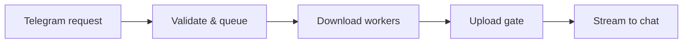

# Hey, I’m Gazzy.
### Full-stack developer · Automation builder · GazzyLabs

I build dashboards, bots, and tools that solve everyday problems — from the interface people use to the services that keep it running.

[Explore my work](#selected-work) · [Technical toolkit](#technical-toolkit) · [Under the hood](#under-the-hood) · [Work together](#work-together)

> **Open to freelance projects, product collaborations, and open source.**  
> Interested in useful software, reliable systems, and turning an idea into a working product.

## Selected work

### 🛰️ NetDash
**Know what broke. Understand why.**

Network monitoring with a live dashboard, incident diagnosis, and Telegram alerts. Local probes and a cloud sentinel help distinguish home-network failures from ISP outages.

`React` `Node.js` `Python` `PostgreSQL`

[View showcase →](https://github.com/gazzy-source/netdash-showcase) · [Code highlights](https://github.com/gazzy-source/netdash-showcase/blob/main/docs/HIGHLIGHTS.md)

Engineering highlights — resilience, privacy, observability

- Buffers telemetry offline and replays it when connectivity returns.
- Uses separate owner and visitor APIs to keep network details private.
- Cross-checks local observations against an external sentinel.
- Turns incidents into explanations and next steps.

The public showcase includes architecture, screenshots, and code excerpts. The full application source is private.

### ⚙️ All-Media Downloader
**A Telegram bot with systems engineering underneath.**

Download supported public media, choose a format, and receive the file in chat. Designed around the limits of a small, self-hosted server.

`Python` `asyncio` `SQLite` `FFmpeg` `Linux`

[Explore source →](https://github.com/gazzy-source/all-media-downloader) · [Architecture](https://github.com/gazzy-source/all-media-downloader/blob/main/docs/ARCHITECTURE.md) · [Design decisions](https://github.com/gazzy-source/all-media-downloader/blob/main/docs/DECISIONS.md)

Engineering highlights — concurrency, memory, backpressure

- Fair download queues and per-user concurrency limits.
- Separate upload admission with an in-flight byte budget.
- Disk-streamed uploads instead of loading whole files into memory.
- Coalesced metadata requests, bounded caches, and SQLite WAL history.

### 🧩 Project Learnings
**Learn system design from systems that exist.**

An interactive knowledge base connecting code, production behavior, and computer-science concepts through walkthroughs, simulations, and practice questions.

`TypeScript` `React` `Local-first`

[Try the app →](https://project-learnings.netlify.app) · [Explore source](https://github.com/gazzy-source/project-learnings)

Inside the app — interactive learning and evidence

- Explore queues, upload admission, memory, and capacity through simulations.
- Practice with flashcards, progressive questions, and mock interviews.
- Keep learning progress and bookmarks in browser-local storage.
- Distinguish measured results, code-derived facts, and illustrative examples.

## Technical toolkit

| Focus | Tools | Applied to |
| :--- | :--- | :--- |
| **Web interfaces** | React · TypeScript · JavaScript | Dashboards, PWAs, interactive learning |
| **Backend & automation** | Python · Node.js · Telegram APIs | Collectors, bots, async job processing |
| **Data & reliability** | PostgreSQL · SQLite · Caching | Telemetry, history, replay, bounded queues |
| **Deployment & operations** | Linux · systemd · GitHub Actions · Netlify | Services, CI, monitoring, web delivery |

## Under the hood

A simplified request path through **All-Media Downloader**:

What I pay attention to when building

**Resource limits.** Concurrency, memory, and bandwidth shape the design; queues and admission controls make those limits explicit.

**Failure behavior.** Offline replay, monitoring states, and actionable alerts help users understand what happened.

**Maintainability.** Architecture notes, documented trade-offs, and automated checks make the next change easier.

[Read an architecture walkthrough](https://github.com/gazzy-source/all-media-downloader/blob/main/docs/ARCHITECTURE.md) · [Explore engineering lessons](https://project-learnings.netlify.app)

## Building in public

<!-- METRICS:START -->
**3 public repositories** · **1 star** · **0 forks** · **0 followers**

Python: 1 · TypeScript: 1. Updated 2026-10-20 UTC.
<!-- METRICS:END -->

About these numbers

Updated daily from public GitHub data. The profile repository is excluded. Stars and forks count original repositories only; languages reflect primary repository languages. Private client work is not included.

[Browse repositories](https://github.com/gazzy-source?tab=repositories) · [Refresh status](https://github.com/gazzy-source/gazzy-source/actions/workflows/profile.yml)

---

## Work together

**Dashboards & web apps · Bots & integrations · Python automation**

Have a product idea or a workflow that needs improving? Share what you’re building, who it’s for, and where you need help.

[Start a conversation →](https://github.com/gazzy-source/netdash-showcase/issues/new?title=Project%20enquiry)

The link opens a public GitHub issue. A brief, non-confidential introduction is enough.
